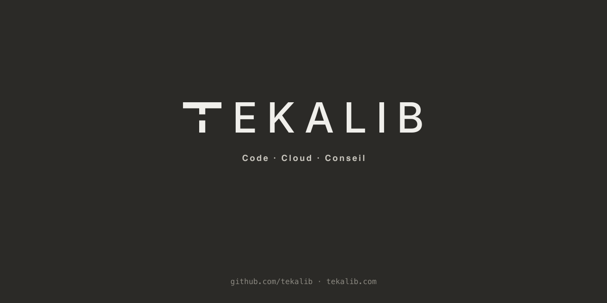

# tekalib/.github

The organization-wide defaults of [Tekalib](https://tekalib.com): the public profile shown on
[github.com/tekalib](https://github.com/tekalib) and the community health files that every
repository of the organization inherits.

  
  

---

  

## Security

Do not open a public issue for a vulnerability. Follow [SECURITY.md](SECURITY.md) and use
GitHub private vulnerability reporting from the affected repository's **Security** tab.

## Links

[Website](https://tekalib.com) · [X / Twitter](https://x.com/tekalibhq) ·
[Instagram](https://instagram.com/tekalibhq) · [Facebook](https://www.facebook.com/profile.php?id=61592786053963)
